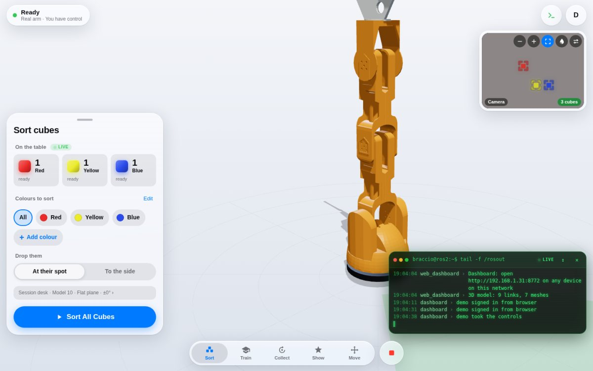
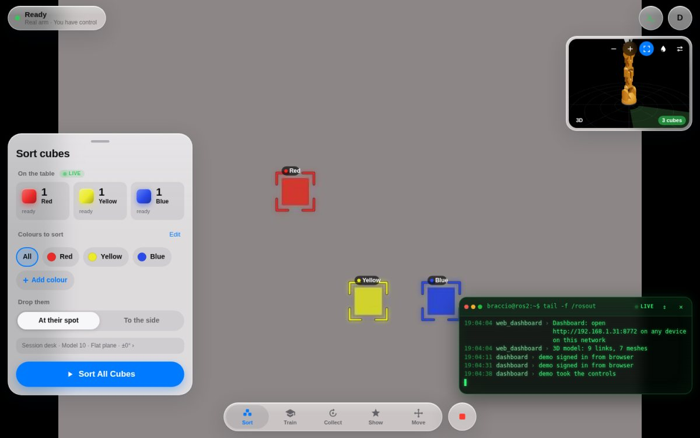
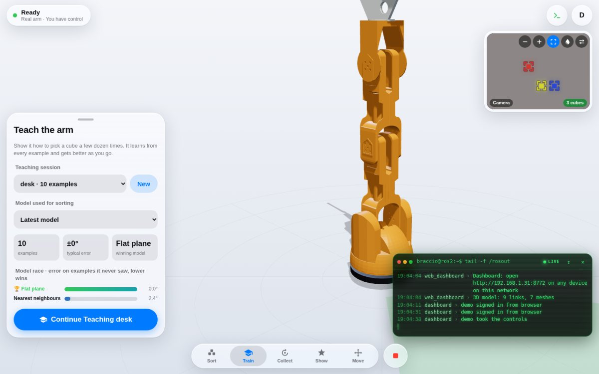
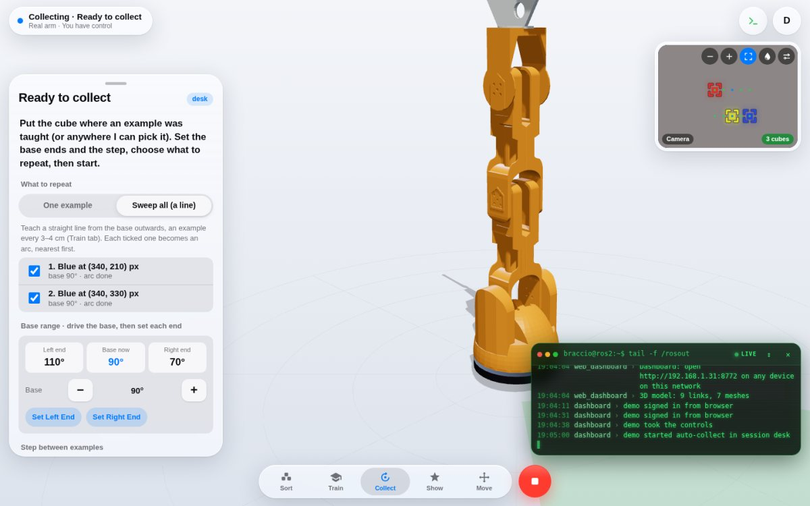
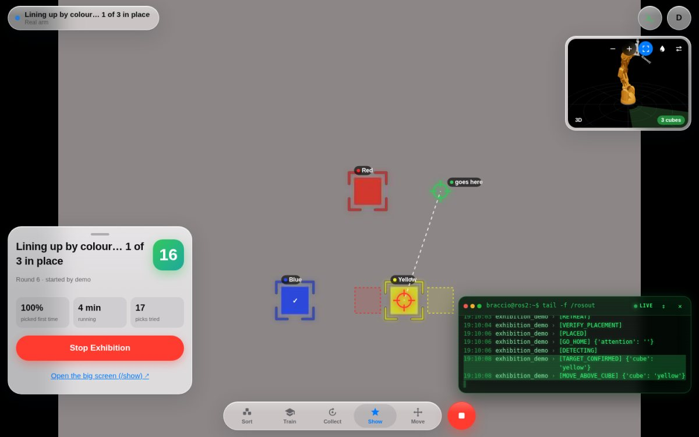
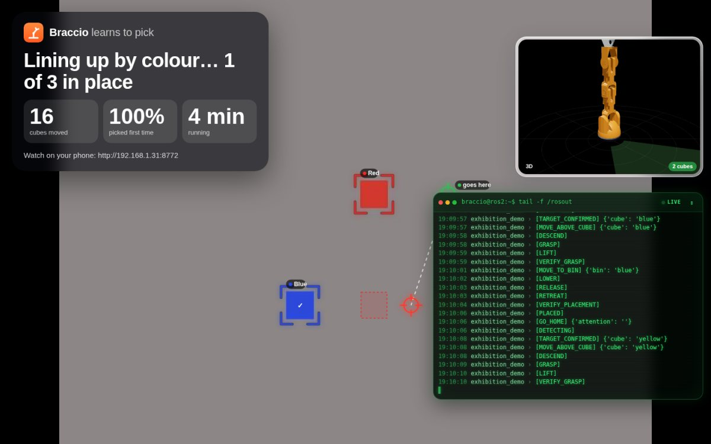
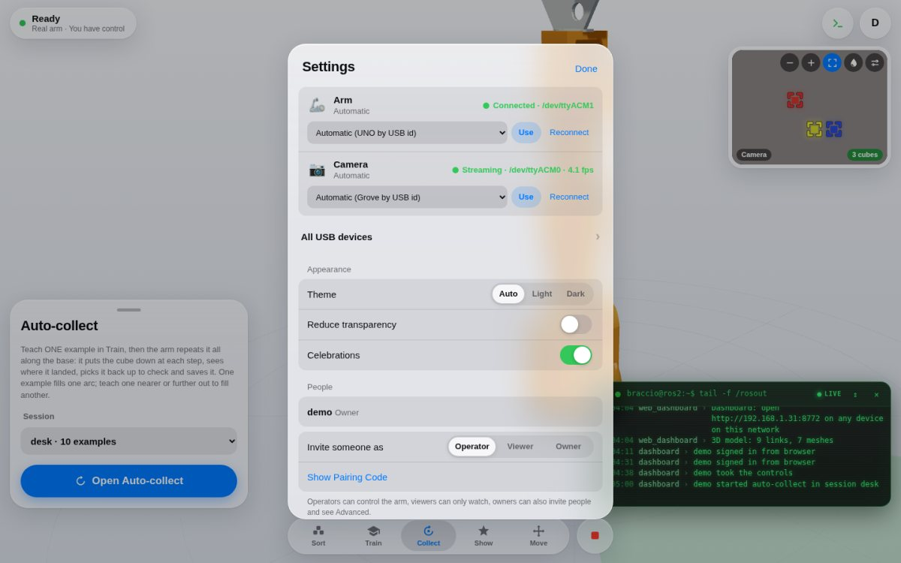
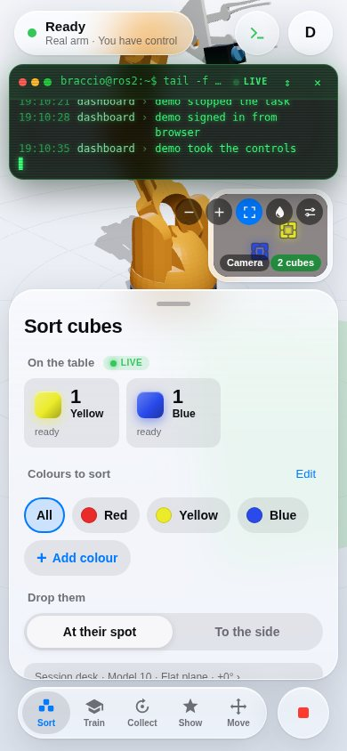

# Arduino Braccio + ROS 2

A TinkerKit Braccio arm that finds coloured cubes with an overhead camera and
sorts them. On the **real arm** (Arduino UNO over USB serial) you teach it to
pick by driving it onto cubes a few times; a small learned model (kNN) then
maps what the camera sees straight to servo angles, so no camera or arm
calibration is needed. It can collect most of its examples by itself, and an
**exhibition mode** keeps it making patterns with the cubes for hours.
Everything is watched and driven from a **web page** on any phone or laptop,
so it runs headless on a **Raspberry Pi 5**. In **Gazebo simulation** it uses
inverse kinematics.

<p align="center">
  
</p>

| Gazebo simulation | Real Braccio |
|---|---|
|  |  |

**Contents:** [Run it](#run-it-one-command) · [Web dashboard](#web-dashboard) ·
[Exhibition](#exhibition-mode) · [Raspberry Pi 5](#raspberry-pi-5-ubuntu-server) ·
[Build (PC)](#build-pc) · [Simulation](#simulation) · [Real arm](#real-arm-arduino-uno) ·
[How it learns](#how-it-learns-to-pick) · [Without the web page](#without-the-web-page-terminal-tools) ·
[Move the arm](#move-the-arm) · [Vision](#vision-and-edge-impulse) · [Troubleshooting](#troubleshooting) ·
[Layout](#repository-layout) · [Docs](#more-documentation) · [What next](docs/learning_roadmap.md)

## Run it: one command

One launch starts everything; you then do it all from the web page.

| You want | Run |
|---|---|
| **Real arm, everything in the web page** (Raspberry Pi or any computer) | `ros2 launch unoq_braccio_bringup pi.launch.py` |
| The same, **plus RViz** on this screen | `ros2 launch unoq_braccio_bringup pi.launch.py rviz:=true` |
| **Simulation** (Gazebo) with the web page | `ros2 launch unoq_braccio_bringup sim.launch.py web:=true` |

`pi.launch.py` starts the serial bridge to the UNO, the overhead camera, cube
detection, the 3D model and the web dashboard. It finds the UNO and the Grove
camera by their USB ids, on whatever port they land, and reconnects when they
are re-plugged. It prints the address, e.g. `http://192.168.1.31:8000`: open
it on any phone or computer on the same network. The first time, enter the
pairing code the terminal shows to create the owner account.

Options, all optional: `camera:=0` (USB webcam),
`camera:=http://<phone-ip>:8080/video` (phone with IP Webcam),
`camera:=grove:/dev/grove_vision`; `serial_port:=/dev/ttyACM0`;
`web_port:=8080`; `speed:=40`; `grove_resolution:=0|1|2`. The camera can also
be switched later in the web page (Settings → Devices).

The other launch files and terminal tools still work, for SSH or debugging:
[Without the web page](#without-the-web-page-terminal-tools).

## Web dashboard

Watch and control the arm from any phone, tablet or computer on the same
network: a live 3D model of the arm (the same URDF and transforms RViz uses),
the overhead camera, what the arm is doing, and the controls. It works with
the real arm and with the simulation.

Start it with [the one command](#run-it-one-command) (or `sim.launch.py web:=true`).

| | |
|---|---|
| <br>**Sort**: the cubes it sees, colours, 3D arm, camera, live log | <br>**Camera** enlarged: a labelled box around every cube |
| <br>**Train**: teach examples, the model race | <br>**Collect**: Sweep all turns a taught line into a grid |
| <br>**Show** running: pattern targets and the next move | <br>**`/show`**: the big screen for a TV |
| <br>**Settings → Devices**: arm and camera, found by USB id | <br>**On a phone** |

The terminal prints the address (e.g. `http://192.168.1.31:8000`) and, the
first time, a **pairing code**: open the address, enter the code and choose a
name and password. That makes you the owner. Invite others in Settings →
**Show Pairing Code**: each code works once, for 10 minutes, as an
**operator** (can control), **viewer** (can only watch) or **owner** (can also
invite people and see Advanced).

| Where | What |
|---|---|
| Sort | **On the table**: the cubes the camera sees right now, per colour, and whether the model has been taught where they are (or, when it sees none, why: no colours saved, a blob too big or cut off). Pick colours (or All), drop at their spot or to the side, Start. Shows each step live, the cubes placed and a counter. **Add colour**: put a cube on the table, tap it in the camera picture, name it, save (same name = measure it again); **Edit** removes colours |
| Train | Teach the arm from the browser, the same flow and sessions as `teach_pick`: pick or create a session, **Record Example** (Above → Grab → Close → Check, driving with the on-screen +/− buttons), **Test Me**, drop spots, review, undo. Shows the "model race" (each candidate's error) and lets you choose the model Sort uses |
| Collect | **Auto-collect**: teach ONE example in Train, set the base's two ends and a step (3/5/10°); the arm repeats that example at every step: puts the cube down, reads where it landed, picks it back up to check, saves it. One example fills one arc; **Sweep all** sweeps every ticked taught example in turn, so a straight line of 4–6 examples taught from the base outwards becomes a grid over the whole table. Only asks for OK to hand over or put back a lost cube. Dots on the camera show the covered spots |
| Show | Exhibition mode: base window, playlist of patterns, rests, Start / Stop, counters; link to the `/show` big screen |
| Move | Gripper open / close, Home and other poses; Joints (folded away) has a slider per servo |
| Stop (red, bottom right) | Stops the task (or teaching's current move) and holds the arm where it is. Always there; `Esc` on a keyboard |
| Camera (top right) | Tap to swap with the 3D view. Boxes and labels mark the cubes it sees, dashed boxes the coloured blobs it rejected and why, the cube being picked and where it goes, and an exhibition pattern's targets. Buttons: smaller / bigger, boxes on / off, 💧 colour mask (paints every pixel of each saved colour, to check a colour still matches), picture adjust (zoom, brightness, contrast, rotate, mirror; kept per browser) |
| Live log (`>_`, bottom right) | Every ROS node's log (`/rosout`), live, green on black; warnings amber, errors red |
| Settings | Account, **Devices** (arm and camera status, every USB serial device and camera; owners can pin the arm or camera to a port, switch to another camera or a stream URL, or reconnect, with no restart), theme, Reduce Transparency, Celebrations, people; Advanced: examples review, drop mode, raw servo values |
| `/show` | The big screen for a TV: what the arm is doing in large type, counters, camera, 3D arm and live log |

Only one person drives at a time; others see who is in control and can take
over. Drag to orbit the 3D view, pinch or scroll to zoom, double-click to reset.
Accounts are in `~/.ros/braccio_web.yaml` (salted password hashes; delete an
entry to remove someone). After an update, a normal reload of the page is
enough (the page is never cached). Port: `web_port:=8080` on the launch. For
HTTPS on an untrusted network, run the dashboard on its own with
`ros2 run unoq_braccio_driver web_dashboard --ros-args -p certfile:=... -p keyfile:=...`.

## Exhibition mode

For a show: the arm keeps moving cubes around the table on its own for
hours, making one pattern after another from a **playlist**: *line up by colour*, *circle* (the cubes on one collected arc), *colour zones*, *swap* two cubes (through a free spot) and *shuffle*. The camera shows each pattern's targets as ghost squares, the big screen narrates ("Making a circle… 2 of 3 in place"), and a finished shape gets confetti and a wave, nod or dance. It rests between rounds so the servos cool down. Patterns only use known spots (taught or auto-collected examples), placing with each spot's own pose, so a dense grid from **Collect → Sweep all** makes the neatest shapes. In the web dashboard's **Show** tab:

1. **Base window**: drive the base with − / + to the furthest it may turn one
   way, **Set Left End**; the other way, **Set Right End**. The window shows
   as a green wedge in the 3D view.
2. Choose the patterns in the **playlist**, the rest (15 s – 2 min) and cubes
   moved per shuffle, then **Start Exhibition**.
3. Open **`http://<pi>:8000/show`** on a TV or monitor: a big screen with what
   the arm is doing, cubes moved, success rate, the camera, the 3D arm and the
   live log (sign in once, as a viewer).

Cubes are only ever put down on **taught spots** (places where a cube really
sat and the arm really picked it up), inside the base window, and at least two
cube widths from any other cube, so they never land off the table or on each
other. Teach spots across the whole area you want used (keep them away from
the table edge), and keep the cubes inside it.

It stops and shows **Needs a hand** (on the page and the big screen) when a
cube goes missing (it carries on by itself once it sees them all again, or
with fewer cubes after a few more looks), after 3 missed picks in a row, or
when no free spot is left. Settings are in `~/.ros/braccio_exhibition.yaml`
and are re-read every round. From a terminal:
`ros2 run unoq_braccio_driver exhibition_demo --ros-args -p session:=<name>`.

## Raspberry Pi 5 (Ubuntu Server)

The arm, the camera and the web dashboard run on a Pi 5 with no screen; you
use it from a browser. Raspberry Pi OS is not supported (there are no ROS 2
Jazzy packages for it): use **Ubuntu Server 24.04 (64-bit)**.

**Hardware:** Pi 5 with the official 5 V / 5 A USB-C supply (a weaker supply
limits USB current), the Arduino UNO + Braccio shield with its own 5 V / 4 A+
servo supply, and the overhead camera (a Grove Vision AI V2 with its
Raspberry Pi camera, or a USB webcam). Plug the UNO and the camera straight
into the Pi, or use a **powered** USB hub: an unpowered hub can drop both
boards mid-run.

1. **Flash the SD card** with Raspberry Pi Imager: *Other general-purpose OS →
   Ubuntu → Ubuntu Server 24.04 LTS (64-bit)*. In its settings, set the user,
   Wi-Fi and enable SSH. Boot the Pi and SSH in.

2. **Install ROS 2 Jazzy, the light version** (no desktop, RViz or Gazebo),
   following the official [Ubuntu install guide](https://docs.ros.org/en/jazzy/Installation/Ubuntu-Install-Debs.html)
   to add the ROS apt source, then:

   ```bash
   sudo apt update
   sudo apt install -y ros-jazzy-ros-base ros-jazzy-xacro ros-jazzy-cv-bridge \
     python3-colcon-common-extensions python3-opencv python3-serial python3-yaml \
     python3-numpy python3-pip git
   echo "source /opt/ros/jazzy/setup.bash" >> ~/.bashrc && source ~/.bashrc
   ```

3. **Get the code and build** (only the three packages the arm needs; `rosdep`
   is skipped on purpose, it would install Gazebo):

   ```bash
   git clone <this repository> ~/unoq-braccio
   cd ~/unoq-braccio/ros2_ws
   colcon build --symlink-install --packages-select unoq_braccio_sim unoq_braccio_driver unoq_braccio_bringup
   echo "source ~/unoq-braccio/ros2_ws/install/setup.bash" >> ~/.bashrc && source ~/.bashrc
   ```

   With `--symlink-install`, a later `git pull` needs no rebuild for Python
   or web page changes (rebuild after adding files or new programs).

4. **Grove Vision AI V2 driver** (skip it for a USB webcam):

   ```bash
   pip install --break-system-packages -e <path to>/ROS--2-Ten-Months-Challenge/test_camera
   ```

5. **USB names and permission** (once; then log out and back in):

   ```bash
   bash ~/unoq-braccio/scripts/setup_uno_serial.sh
   ```

   This gives the UNO `/dev/braccio` and the Grove board `/dev/grove_vision`,
   adds you to `dialout`, and stops ModemManager probing them. Not strictly
   needed (both are also found by USB id), but it keeps names stable.

6. **Flash the UNO** once, from the Pi or any PC: see [Real arm](#real-arm-arduino-uno).

7. **Start everything** ([the one command](#run-it-one-command)):

   ```bash
   ros2 launch unoq_braccio_bringup pi.launch.py
   ```

   It finds the UNO and the Grove camera by USB id whichever port they land
   on (and reconnects when they are re-plugged), starts the web dashboard
   with no RViz, and prints the address, e.g. `http://192.168.1.31:8000`.
   Open it on a phone or laptop on the same network; the first time, enter
   the pairing code the terminal shows. Other cameras:
   `pi.launch.py camera:=0` (USB webcam), or pick one later in
   **Settings → Devices**. Options: `web_port:=8080`, `speed:=40`,
   `grove_resolution:=0|1|2`.

8. **Then, in the browser:** Sort → **Add colour** (tap each cube colour
   once), Train → teach a few examples, Collect → let it collect the rest,
   Show → start the exhibition. See [Web dashboard](#web-dashboard).

**Keep it running after you log out:** run the launch inside `tmux`, or as a
service so it also starts at boot and restarts if it stops:

```bash
sudo tee /etc/systemd/system/braccio.service > /dev/null <<UNIT
[Unit]
Description=Braccio arm and web dashboard
After=network-online.target
Wants=network-online.target

[Service]
User=$USER
ExecStart=/bin/bash -lc 'source /opt/ros/jazzy/setup.bash && source $HOME/unoq-braccio/ros2_ws/install/setup.bash && exec ros2 launch unoq_braccio_bringup pi.launch.py'
Restart=on-failure
RestartSec=5

[Install]
WantedBy=multi-user.target
UNIT
sudo systemctl daemon-reload && sudo systemctl enable --now braccio
journalctl -u braccio -f          # its log (the web page's live log shows the same)
```

Update later with `cd ~/unoq-braccio && git pull`, then
`sudo systemctl restart braccio` (or Ctrl+C and start the launch again).

## Build (PC)

A desktop or laptop with Ubuntu 24.04 + ROS 2 Jazzy Desktop, for the
simulation and for development (for the Pi see
[above](#raspberry-pi-5-ubuntu-server)). Full install steps for each OS:
[docs/platform-setup.md](docs/platform-setup.md).

```bash
sudo apt install ros-jazzy-ros-gz ros-jazzy-gz-ros2-control ros-jazzy-ros2-control \
  ros-jazzy-ros2-controllers ros-jazzy-xacro
cd ros2_ws
rosdep install --from-paths src --ignore-src -r -y
colcon build --symlink-install
source install/setup.bash
```

Run `source ros2_ws/install/setup.bash` in every new terminal.

## Simulation

```bash
ros2 launch unoq_braccio_bringup sim.launch.py                 # Gazebo + RViz + cameras
```

In a second terminal:

```bash
ros2 run unoq_braccio_driver pick_place_demo                   # sort every cube into its bin
ros2 run unoq_braccio_driver pick_place_demo --ros-args -p colors:="[blue]"   # one colour only
ros2 topic echo /task/state                                    # watch the state machine
```

The pick-and-place goes through these states:
`DETECTING → MOVE_ABOVE_CUBE → DESCEND → GRASP → LIFT → MOVE_TO_BIN → RELEASE → VERIFY_PLACEMENT → COMPLETE`.
Red cubes go to the green bin, blue to cyan, yellow to magenta.

Launch options:

```bash
ros2 launch unoq_braccio_bringup sim.launch.py rviz:=false                  # Gazebo only
ros2 launch unoq_braccio_bringup sim.launch.py detector_backend:=color_blob # no ML model
ros2 launch unoq_braccio_bringup sim.launch.py model_path:=/path/model.lite # your own model
```

How the simulation works (cameras, detection tuning, grasp assist, servo
conventions): [ros2_ws/src/unoq_braccio_sim/README.md](ros2_ws/src/unoq_braccio_sim/README.md).

## Real arm (Arduino UNO)

```text
PC / Raspberry Pi 5 (ROS 2, camera)  --USB-->  Arduino UNO + Braccio shield  -->  6 servos
```

**Hardware:** TinkerKit Braccio with its shield on an Arduino UNO R3 (R4
Minima/WiFi also work), a 5 V supply of 4 A or more for the servos, and an
overhead camera: a Grove Vision AI V2 with its Raspberry Pi camera
(`camera:=grove`, see [docs/camera.md](docs/camera.md)), a USB webcam
(`camera:=0`), or a phone running the IP Webcam app
(`camera:=http://<phone-ip>:8080/video`). Power the servos from the shield's
own supply, never from USB.

1. **Flash the UNO** (once):

   ```bash
   bash scripts/flash_uno.sh /dev/ttyACM0            # Linux
   ```
   ```powershell
   .\scripts\flash_uno.ps1 -Port COM3                # Windows
   ```

2. **Serial port setup** (once on Linux: fixed name `/dev/braccio` + permission):

   ```bash
   bash scripts/setup_uno_serial.sh                  # then log out and back in
   ```

3. **Start it** with [the one command](#run-it-one-command) and check the
   arm moves from the web page's **Move** tab (Home, gripper Open / Close).
   On power-up the arm stands straight up and waits about 8 s while the UNO
   resets and powers its servos gently. Wiring, serial protocol and
   troubleshooting: [docs/hardware.md](docs/hardware.md).

## How it learns to pick

**Easiest: in the web dashboard.** Train tab → record a few examples with
the on-screen buttons, then Collect tab → **Sweep all**:
teach a straight line of 4–6 examples from the base outwards and the arm
collects an arc of examples from each one by itself. Cube colours: Sort tab →
**Add colour**, tap the cube in the camera picture. See
[Web dashboard](#web-dashboard). The [terminal tools](#without-the-web-page-terminal-tools)
do the same and write the same sessions.

Each example stores what the camera saw (cube position and angle) and the
servo angles you drove the arm to. The model blends the nearest examples
(kNN), so servo offsets, bent links and a tilted camera do not matter: it
repeats what the real arm did. Every 5 examples it also tries polynomial and
small neural-network models and keeps whichever predicts best.

**Mount the camera** looking down at the table, so it sees the whole area
where cubes go. Do not move or zoom it afterwards (if you do, start a new
session).

Tips that matter most:

- **Spread the examples** over the whole area, about every 3-4 cm, with the
  cube at different angles. 25-40 examples cover a desk-sized area.
- **Reach each spot the same way.** Keep a similar posture (e.g. elbow high,
  wrist tipped down) in neighbouring examples; two different postures for
  the same spot get averaged into one that misses.
- Every 5 examples it offers a **test**: put a cube anywhere, the arm picks on
  its own (`s` stops it). If it misses, answer `y` to "Correct it?" and drive
  it onto the cube: that becomes an example exactly where it was weakest.
- Cubes more than 60 px from every example are refused, not guessed.

**Review and clean up.** Train → **Review** (or Settings → Advanced → Examples review) lists examples whose angles disagree with their neighbours or whose camera reading wobbled, offers to delete them, and shows where tests missed so you know where to teach more.

**Where sorted cubes go.** Either teach a drop spot per colour (Train → **Drop Spots**), or skip it: then cubes are dropped at the far end of the base rotation, reaching out as far as they were picked.

## Without the web page (terminal tools)

The web page does all of this; these are for SSH, scripting or debugging. They use the same sessions (`~/.ros/braccio_teach/<session>/`) and settings files as the web page.

### Arm only (check it moves, no camera)

```bash
ros2 launch unoq_braccio_bringup hardware.launch.py serial_port:=auto     # or /dev/braccio, /dev/ttyACM0
```

The arm stands up and waits about 8 s while the UNO resets. Wiring and protocol: [docs/hardware.md](docs/hardware.md).

### Teach in the terminal

**Start the arm and camera** (terminal 1; it includes `hardware.launch.py`,
never run both; `web:=true` adds the web page):

```bash
ros2 launch unoq_braccio_bringup real.launch.py serial_port:=/dev/braccio \
  camera:=http://192.168.1.192:8080/video
```

**Cube colours** (terminal 2). Put one cube under the camera,
`s` saves its colour, next cube, `n` when done. Run it again any time to add a
colour; the ones already saved are kept (`x` forgets them).

```bash
ros2 run unoq_braccio_driver real_setup --ros-args -p steps:=colors
```

Restart terminal 1 after adding colours.

**Record examples** (terminal 2):

```bash
ros2 run unoq_braccio_driver teach_pick --ros-args -p session:=new
```

For each example, put ONE cube down and press Enter. The camera reads it, then:

| Stage | You do |
|---|---|
| ABOVE | Drive the open gripper above the cube, Enter |
| GRAB | Lower the open fingers around it, Enter |
| CLOSE | Close (`C`), lift (e.g. `k`), Enter |
| CHECK | `y` if it holds the cube (saved), `n` if not (not saved) |

Keys: `j`/`l` base, `i`/`k` shoulder, `y`/`h` elbow, `t`/`g` wrist, `r`/`f`
roll, `o`/`c` gripper (`O` open, `C` grip), Tab switches 1/5 degree steps,
Esc cancels the example. From the second example on, the arm starts at its own
guess, so you only correct it.

Menu keys: Enter record · `T` test · `D` drop poses · `R` review · `U` undo
last example · `Q` quit. Everything is saved in
`~/.ros/braccio_teach/<session>/`; run the same session again to continue.

**Review:** press `R` in `teach_pick` (or, without the arm,
`python3 -m unoq_braccio_driver.pick_learning desk` from
`ros2_ws/src/unoq_braccio_driver`). It lists examples whose angles disagree
with their neighbours or whose camera reading wobbled, offers to delete them,
and shows where tests missed so you know where to teach more.

**Drop poses:** `D` in `teach_pick` teaches one per colour; without them: then cubes are dropped at the far end of the base
rotation (`l` key direction), reaching out as far as they were picked.

### Sort in the terminal

**Sort** (terminal 2, with terminal 1 still running):

```bash
# every colour, until no cube it can pick is left
ros2 launch unoq_braccio_bringup learned_pick_place.launch.py session:=desk

# one colour, leave the others
ros2 launch unoq_braccio_bringup learned_pick_place.launch.py session:=desk colors:=red

# several colours, always drop at the side (ignore taught drop poses)
ros2 launch unoq_braccio_bringup learned_pick_place.launch.py session:=desk colors:=red,blue drop:=side
```

Options: `drop:=auto` (taught pose if there is one, else side; default),
`drop:=taught` (only colours with a taught pose), `drop:=side`;
`drop_base:=0` the base angle for side drops; `model:=model_0010` an older
model; `unsure_px:=60` how far from examples it still tries. Each pick is
checked with the camera; a cube is tried twice before it is left. Ctrl+C
freezes the arm. Watch it with `ros2 topic echo /task/state`.

### Live demo: copy and paste

Terminal 1, the arm and camera (keep it running; `web:=true` also starts the
[web dashboard](#web-dashboard)):

```bash
ros2 launch unoq_braccio_bringup real.launch.py serial_port:=/dev/braccio \
  camera:=http://192.168.1.192:8080/video web:=true
```

Terminal 2. Add a colour first if it is new (one cube under the camera, `s`,
then `n`; restart terminal 1 afterwards):

```bash
ros2 run unoq_braccio_driver real_setup --ros-args -p steps:=colors
```

Pick only one colour (here red) out of the others, dropping at the far end of
the `l` key:

```bash
ros2 launch unoq_braccio_bringup learned_pick_place.launch.py session:=new colors:=red drop:=side
```

Pick every colour, continuously until none are left, all dropped at the `l` end:

```bash
ros2 launch unoq_braccio_bringup learned_pick_place.launch.py session:=new drop:=side
```

Use your session name (`new` here) and the colour names `real_setup` printed.
Only cubes within 60 px of taught examples are picked, and the side drops all
land in one spot, so keep it clear.

Before kNN, the real arm used a measured camera and inverse kinematics
(`real_setup` with all steps, then `real_pick_place.launch.py`). That still
works and is described in [docs/camera.md](docs/camera.md), but it needs
careful calibration and missed more often.

### Other launch files

| Launch | What |
|---|---|
| `pi.launch.py` | **The one to use**: real arm + camera + web page ([Run it](#run-it-one-command)) |
| `real.launch.py` | The same pieces with every option (`camera:=`, `serial_port:=`, `web:=true`, `rviz:=`, `detector_backend:=` …); `pi.launch.py` is this with good defaults |
| `hardware.launch.py` | Arm only (serial bridge + 3D model) |
| `sim.launch.py` | Gazebo simulation (`web:=true` for the web page) |
| `learned_pick_place.launch.py` | Sort with a taught model, from a terminal |
| `manual_control.launch.py`, `joint_state_publisher_gui.launch.py` | Drive the joints by keyboard, joystick or sliders |
| `real_pick_place.launch.py`, `vision_*.launch.py`, `edge_impulse_*.launch.py`, `data_capture.launch.py`, `remote.launch.py` | Older set-ups: measured camera + IK, Edge Impulse, the UNO Q |

## Move the arm

These work the same in simulation and on the real arm.

```bash
ros2 run unoq_braccio_driver pose_demo --ros-args -p pose:=ready    # rest, ready, grip_test, grip_full, pickup, drop, wave
ros2 run unoq_braccio_driver ik_pose_demo --ros-args -p x:=0.20 -p y:=0.0 -p z:=0.10 -p gripper:=25   # metres
ros2 run unoq_braccio_driver manual_control --ros-args -p input_type:=keyboard
ros2 launch unoq_braccio_bringup manual_control.launch.py input_type:=joystick controller_type:=xbox
ros2 launch unoq_braccio_bringup joint_state_publisher_gui.launch.py          # slider window
```

Send raw servo angles (degrees: base, shoulder, elbow, wrist_vertical, wrist_rotation, gripper):

```bash
ros2 topic pub --once /braccio/joint_command sensor_msgs/msg/JointState \
  "{name: [base, shoulder, elbow, wrist_vertical, wrist_rotation, gripper], position: [90, 90, 90, 90, 90, 25]}"
```

Controls and gripper calibration: [docs/manual_control.md](docs/manual_control.md).

## Vision and Edge Impulse

In simulation the cube detector uses an Edge Impulse model to find the cubes
(colour then decides which cube is which). On the real arm the default is
plain colour detection with the colours learned by `real_setup`: it is steadier
than the 64x64 model on a real camera. Use the model there with
`real.launch.py detector_backend:=edge_impulse`. The model (~156 MB) is too
big for GitHub, so download it once; without it the detector falls back to
plain colour detection and logs a warning.

```bash
ros2 run unoq_braccio_driver download_model                  # saves it to ~/unoq-braccio/ (resumable, Ctrl+C safe)
pip install --break-system-packages ai-edge-litert 'numpy<2' # TFLite runtime, once; numpy<2 keeps Ubuntu's OpenCV working
```

Restart the launch afterwards; it should log `Cube detector: Edge Impulse model '...'`.

- Cube detection project (this model): <https://studio.edgeimpulse.com/studio/975321>
- Direct model link (float32): <https://studio.edgeimpulse.com/v1/api/975321/learn-data/3/model/tflite-float>

```bash
ros2 launch unoq_braccio_bringup vision_usb.launch.py camera_index:=0 label:=object    # USB camera on the ROS machine
cd test && python detect.py                                                           # try the cube model on images, no ROS
```

Public Edge Impulse project: <https://studio.edgeimpulse.com/studio/1029890>.
Keep API keys in `EDGE_IMPULSE_API_KEY`, never in committed files. Details:
[docs/vision.md](docs/vision.md), [edge_impulse/README.md](edge_impulse/README.md),
[test/README.md](test/README.md).

## Troubleshooting

| Problem | Command |
|---|---|
| Sim arm does not move | `ros2 topic hz /clock` (must tick) and `ros2 control list_controllers` |
| Is anything commanding the arm? | `ros2 topic echo /braccio/joint_command` |
| Real arm status | `ros2 topic echo /braccio/firmware_status` |
| Real camera: which cubes does it see? | open `teach_pick`: its menu line shows the cubes it sees right now |
| Learned picks miss | `R` in `teach_pick`, then teach where it misses |
| Which serial port? | `ls /dev/ttyACM* /dev/ttyUSB* /dev/braccio`, or Settings → Devices on the web page |
| "No arm found" / "No Grove camera found" | The board is not seen by Linux at all: `lsusb` must list `2341:0043` (UNO) and `1a86:55d3` (Grove). Re-plug the cable or hub; use a powered hub or plug straight in (`journalctl -k \| grep usb` shows drops) |
| Camera sees no cubes | No colours saved, or they were measured with another camera or light: Sort → Add colour, tap each cube again. 💧 on the camera shows what each colour matches; dashed boxes say why a blob was rejected (e.g. held too close: too big) |
| Web page shows old features | Reload it once after an update |
| Layout / IK / protocol / calibration checks (no ROS needed) | `python ros2_ws/src/unoq_braccio_driver/test/test_workspace.py` (also `test_protocol.py`, `test_camera_calibration.py`) |

## Repository layout

```text
firmware/braccio_uno_firmware/   Arduino UNO serial firmware (servos only)
ros2_ws/src/unoq_braccio_driver/ ROS 2 nodes: serial bridge, cameras (camera_node: USB, stream, Grove), vision,
                                 teaching (teach_pick, pick_learning), pick and place (learned_pick_demo),
                                 exhibition (exhibition, exhibition_demo), web dashboard (web_dashboard,
                                 web_teach, web_collect, web_colors, web_auth), USB devices (usb_devices)
ros2_ws/src/unoq_braccio_sim/    URDF, Gazebo world, controllers
ros2_ws/src/unoq_braccio_bringup/ Launch files (pi.launch.py: the Raspberry Pi; real.launch.py: real arm; sim.launch.py)
scripts/                         Flashing and setup scripts
docs/                            Hardware, vision, roadmap and other guides
edge_impulse/, test/             Edge Impulse integration and the cube model test tool
ros2_ws/src/unoq_braccio_driver/unoq_braccio_driver/web/  Web dashboard page (three.js vendored, works offline)
legacy/uno_q/                    Earlier Arduino UNO Q set-up: App Lab apps, old web app, UNO Q firmware
```

## More documentation

| Topic | Where |
|---|---|
| Raspberry Pi 5 set-up | [above](#raspberry-pi-5-ubuntu-server) |
| Real arm: wiring, protocol, troubleshooting | [docs/hardware.md](docs/hardware.md) |
| Real camera (Grove Vision AI V2 / USB / phone IP Webcam) and calibration | [docs/camera.md](docs/camera.md) |
| What to build next: stacking, building, models | [docs/learning_roadmap.md](docs/learning_roadmap.md) |
| Manual control and gripper calibration | [docs/manual_control.md](docs/manual_control.md) |
| Simulation internals | [ros2_ws/src/unoq_braccio_sim/README.md](ros2_ws/src/unoq_braccio_sim/README.md) |
| Install on Windows / macOS / Linux (PC) | [docs/platform-setup.md](docs/platform-setup.md) |
| Camera vision | [docs/vision.md](docs/vision.md) |
| Edge Impulse integration, data capture | [edge_impulse/README.md](edge_impulse/README.md), [edge_impulse/data_capture.md](edge_impulse/data_capture.md) |
| Roadmap: tutorial plan, new sim features | [docs/roadmap.md](docs/roadmap.md) |
| Earlier Arduino UNO Q set-up (App Lab, old web app) | [legacy/uno_q/README.md](legacy/uno_q/README.md) |
| Two-arm system plan | [docs/two_arm_braccio_system_architecture.md](docs/two_arm_braccio_system_architecture.md) |

## Credits

Built on ROS 2 and Gazebo (Open Robotics), Edge Impulse and Arduino. Arm
meshes and much inspiration from Will Stedden's
[braccio_moveit_gazebo](https://github.com/lots-of-things/braccio_moveit_gazebo)
(GPL-3.0).

## Fun: test the arm

With the arm running (`hardware.launch.py`, `real.launch.py` or `sim.launch.py`),
in a second terminal. Each one ends standing up straight; add
`-p speed:=0.5` for slower or `-p speed:=1.5` for faster.

```bash
ros2 run unoq_braccio_driver arm_tricks --ros-args -p trick:=wave    # waves hello
ros2 run unoq_braccio_driver arm_tricks --ros-args -p trick:=dance   # sways side to side
ros2 run unoq_braccio_driver arm_tricks --ros-args -p trick:=nod     # nods "yes"
ros2 run unoq_braccio_driver arm_tricks --ros-args -p trick:=shake   # shakes "no"
ros2 run unoq_braccio_driver arm_tricks --ros-args -p trick:=bow     # bows, then snaps the gripper
```
