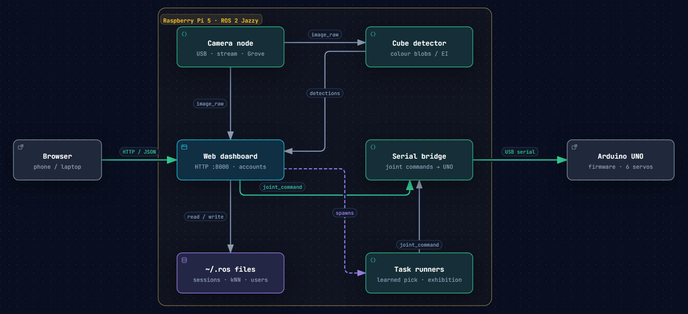

# Arduino Braccio + ROS 2

[](https://docs.ros.org/en/jazzy/)
[](docs/raspberry-pi.md)
[](LICENSE)

A TinkerKit Braccio arm that finds coloured cubes with an overhead camera and
sorts them. You teach it to pick by driving it onto a few cubes; a small learned
model (kNN) maps camera readings straight to servo angles, so no camera or arm
calibration is needed. Everything runs headless on a Raspberry Pi 5 and is
controlled from a web page.

## Build guide

This branch adds a step-by-step guide to rebuilding the project. To read it
locally on Ubuntu 24.04:

```bash
# 1. Install MkDocs (open a new terminal after this step)
sudo apt install pipx
pipx ensurepath
pipx install mkdocs-material --include-deps

# 2. Get this branch
git clone -b build-guide https://github.com/hwivc/unoq-braccio.git
cd unoq-braccio

# 3. Run the guide
mkdocs serve
```

Then open <http://127.0.0.1:8000>. Press `Ctrl+C` to stop.

<p align="center">
  
</p>

| Gazebo simulation | Real Braccio |
|---|---|
|  |  |

## Features

- **Learned picking**: teach a few examples; the arm auto-collects the rest and
  picks anywhere in the taught area.
- **Web dashboard**: live 3D arm, camera, controls and logs on any phone or
  laptop, with owner / operator / viewer accounts.
- **Exhibition mode**: arranges cubes into patterns for hours, with a big-screen
  view for a TV.
- **Simulation**: Gazebo world with inverse-kinematics pick and place.
- **Plug and play**: finds the UNO and camera by USB id and reconnects when
  they're re-plugged.

## Architecture

<p align="center">
  
</p>

`pi.launch.py` runs everything inside the box on the Pi. The web dashboard
sends joint commands to the serial bridge, which drives the UNO over USB, and
starts the sort and exhibition task runners. An interactive version is in
[`docs/architecture.html`](docs/architecture.html): download it and open it in a browser.

## Hardware

- TinkerKit Braccio with its shield on an Arduino UNO R3 (R4 Minima/WiFi also work)
- 5 V, 4 A+ supply for the servos (never power them from USB)
- Overhead camera: Grove Vision AI V2, a USB webcam, or a phone running IP Webcam
- Raspberry Pi 5 with Ubuntu Server 24.04, or any Ubuntu 24.04 PC

Wiring and serial protocol: [docs/hardware.md](docs/hardware.md).

## Quick start

**Raspberry Pi 5:** follow [docs/raspberry-pi.md](docs/raspberry-pi.md).

**PC (Ubuntu 24.04 + ROS 2 Jazzy Desktop):**

```bash
sudo apt install ros-jazzy-ros-gz ros-jazzy-gz-ros2-control ros-jazzy-ros2-control \
  ros-jazzy-ros2-controllers ros-jazzy-xacro
cd ros2_ws
rosdep install --from-paths src --ignore-src -r -y
colcon build --symlink-install
source install/setup.bash
```

Other operating systems: [docs/platform-setup.md](docs/platform-setup.md).

**Run:**

| Mode | Command |
|---|---|
| Real arm + web dashboard | `ros2 launch unoq_braccio_bringup pi.launch.py` |
| Real arm + RViz | `ros2 launch unoq_braccio_bringup pi.launch.py rviz:=true` |
| Simulation + web dashboard | `ros2 launch unoq_braccio_bringup sim.launch.py web:=true` |

Open the printed address (e.g. `http://braccio.local:8000`) and enter the
pairing code from the terminal to create the owner account.

Common options: `camera:=0` (USB webcam), `camera:=http://<phone-ip>:8080/video`,
`serial_port:=/dev/ttyACM0`, `web_port:=8080`, `speed:=40`.

## Real arm

1. Flash the UNO once: `bash scripts/flash_uno.sh /dev/ttyACM0`
   (Windows: `.\scripts\flash_uno.ps1 -Port COM3`).
2. Linux serial setup: `bash scripts/setup_uno_serial.sh`, then log out and back in.
3. Start `pi.launch.py` and test the arm from the **Move** tab.

## How it learns

1. **Sort → Add colour**: tap each cube colour in the camera picture.
2. **Train**: record a few examples by driving the arm onto a cube.
3. **Collect → Sweep all**: teach a line of 4–6 examples from the base outwards,
   and the arm fills a grid over the table by itself.
4. **Sort** or **Show**: pick and place, or start an exhibition.

Each example stores the cube's position and angle in the camera picture, plus
the servo angles that picked it. The model blends the nearest examples, so servo
offsets and a tilted camera don't matter. Every 5 examples it also compares
polynomial and small neural-network models and keeps whichever predicts best.
Mount the camera looking straight down and don't move it afterwards.

## Documentation

| Topic | Link |
|---|---|
| Raspberry Pi 5 setup | [docs/raspberry-pi.md](docs/raspberry-pi.md) |
| Web dashboard and exhibition mode | [docs/web-dashboard.md](docs/web-dashboard.md) |
| Terminal tools, launch files, troubleshooting | [docs/terminal-tools.md](docs/terminal-tools.md) |
| Hardware: wiring, protocol | [docs/hardware.md](docs/hardware.md) |
| Camera setup and calibration | [docs/camera.md](docs/camera.md) |
| Vision and Edge Impulse | [docs/vision.md](docs/vision.md), [edge_impulse/README.md](edge_impulse/README.md) |
| Manual control | [docs/manual_control.md](docs/manual_control.md) |
| Simulation internals | [ros2_ws/src/unoq_braccio_sim/README.md](ros2_ws/src/unoq_braccio_sim/README.md) |
| Install on Windows / macOS / Linux | [docs/platform-setup.md](docs/platform-setup.md) |
| Roadmap | [docs/roadmap.md](docs/roadmap.md), [docs/learning_roadmap.md](docs/learning_roadmap.md) |
| Two-arm system plan | [docs/two_arm_braccio_system_architecture.md](docs/two_arm_braccio_system_architecture.md) |
| Earlier Arduino UNO Q setup | [legacy/uno_q/README.md](legacy/uno_q/README.md) |

## Repository layout

```text
firmware/                 Arduino UNO serial firmware
ros2_ws/src/
  unoq_braccio_driver/    ROS 2 nodes: serial bridge, cameras, vision, learning, web dashboard
  unoq_braccio_sim/       URDF, meshes, Gazebo world, controllers
  unoq_braccio_bringup/   Launch files
scripts/                  Flashing and setup scripts
docs/                     Guides
edge_impulse/, test/      Edge Impulse integration and model test tool
legacy/uno_q/             Earlier Arduino UNO Q setup
```

## Credits

Built on ROS 2 and Gazebo (Open Robotics), Edge Impulse and Arduino. The arm
meshes come from Will Stedden's
[braccio_moveit_gazebo](https://github.com/lots-of-things/braccio_moveit_gazebo)
(GPL-3.0), which also inspired much of the project.

## License

[MIT](LICENSE). The arm meshes in `ros2_ws/src/unoq_braccio_sim/meshes/braccio_stedden/` are GPL-3.0.
