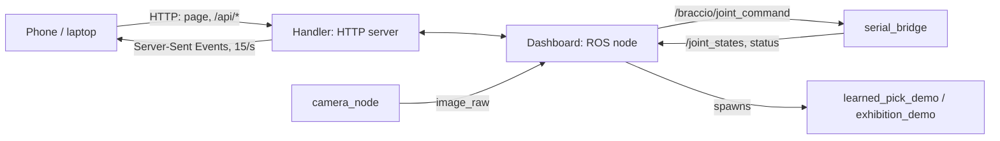

# 12. Web dashboard

## Objective

A web page, served by the Pi, that anyone on the network can open on a phone or
laptop to watch the arm (live 3D model, camera, log) and drive it: teach, sort,
stop. Sign-in is by pairing code.

## Why we need this now

The Pi has no screen, and terminals over SSH are fine for you but not for anyone
else. A web page turns every phone into the arm's control panel. It's also the
last piece before exhibition mode, which runs for hours unattended and needs a
display and a big **Stop** button.

## The design in one picture



Two halves in one process:

- **`Dashboard`** is a ROS node. It subscribes to everything, keeps the latest
  state, and publishes commands.
- **`Handler`** is Python's built-in `http.server`. There's no web framework to
  install. It serves the page and a small JSON API, and **pushes** state to the
  page with Server-Sent Events, so the page never has to poll.

## Create

1. `web_auth.py` and `web_dashboard.py` in the driver package.
2. Copy as-is (support code):
    - the whole `web/` folder (`index.html`, `app.js`, `app.css`, the three.js files in `vendor/`),
    - `web_colors.py`, `web_scene.py`, `web_teach.py`, `web_collect.py`, `gui_to_joint_command.py`,
    - `exhibition.py`. The dashboard imports it now; chapter 13 explains it.
3. Add the entry point: `"web_dashboard = unoq_braccio_driver.web_dashboard:main",`

## The code

### Accounts: who may do what

@code ros2_ws/src/unoq_braccio_driver/unoq_braccio_driver/web_auth.py L1-L36

Passwords are never stored, only a **salted PBKDF2 hash**. `compare_digest`
compares in constant time, so timing can't leak the hash.

@code ros2_ws/src/unoq_braccio_driver/unoq_braccio_driver/web_auth.py Accounts.join

@code ros2_ws/src/unoq_braccio_driver/unoq_braccio_driver/web_auth.py Accounts.login

@code ros2_ws/src/unoq_braccio_driver/unoq_braccio_driver/web_auth.py Accounts.session

@code ros2_ws/src/unoq_braccio_driver/unoq_braccio_driver/web_auth.py Accounts.take

**The control lease:** only one person drives at a time, so two phones can't fight
over the arm. Type the rest of `Accounts` from the original.

### The ROS side: `Dashboard`

@code ros2_ws/src/unoq_braccio_driver/unoq_braccio_driver/web_dashboard.py Dashboard.__init__

It subscribes to the arm, the camera, the task state and **`/rosout`**, which is
every node's log. That's how the page's live log sees everything.

@code ros2_ws/src/unoq_braccio_driver/unoq_braccio_driver/web_dashboard.py Dashboard.snapshot

Everything the page shows, in one dictionary. It's built 15 times a second.

@code ros2_ws/src/unoq_braccio_driver/unoq_braccio_driver/web_dashboard.py Dashboard.send

@code ros2_ws/src/unoq_braccio_driver/unoq_braccio_driver/web_dashboard.py Dashboard.stop

### Starting tasks: reuse, don't rewrite

@code ros2_ws/src/unoq_braccio_driver/unoq_braccio_driver/web_dashboard.py Dashboard.start_task

The Sort button doesn't reimplement sorting. It **starts chapter 10's node** as a
child process (`ros2 run … learned_pick_demo`) and streams its output into the log.
Stop kills it. The terminal and the page share one implementation.

@code ros2_ws/src/unoq_braccio_driver/unoq_braccio_driver/web_dashboard.py Dashboard.stop_task

### The HTTP side: `Handler`

@code ros2_ws/src/unoq_braccio_driver/unoq_braccio_driver/web_dashboard.py Handler.do_GET

Public paths first (the page itself, `/api/me`), then **everything else needs a
session**, and some paths need the `owner` role.

@code ros2_ws/src/unoq_braccio_driver/unoq_braccio_driver/web_dashboard.py Handler.api_events

**Server-Sent Events:** one long HTTP response, `data: {...}\n\n` fifteen times a
second. The browser side is a few lines:

@code ros2_ws/src/unoq_braccio_driver/unoq_braccio_driver/web/app.js L374-L384

@code ros2_ws/src/unoq_braccio_driver/unoq_braccio_driver/web_dashboard.py Handler.do_POST

Every action is a POST. Driving is checked against the lease before anything is sent.

### Starting the server

@code ros2_ws/src/unoq_braccio_driver/unoq_braccio_driver/web_dashboard.py main

The HTTP server runs in a thread; `rclpy.spin` runs the ROS side. On first start
it prints a **pairing code**: the first person to use it becomes the owner.

Type the other `Dashboard` and `Handler` methods from the original. They're each
small, and follow the same patterns as the ones above.

## Run it

```bash
ros2 launch unoq_braccio_bringup real.launch.py serial_port:=auto camera:=0 web:=true
```

Open `http://<pi-address>:8000` on your phone and enter the pairing code from the terminal.
Passes when you see the 3D arm move as you press **Move → Home**, and the camera picture.

## What's next

The arm can sort on command. The last objective is for it to keep going *by itself*
for hours, making patterns for an audience: chapter 13.
