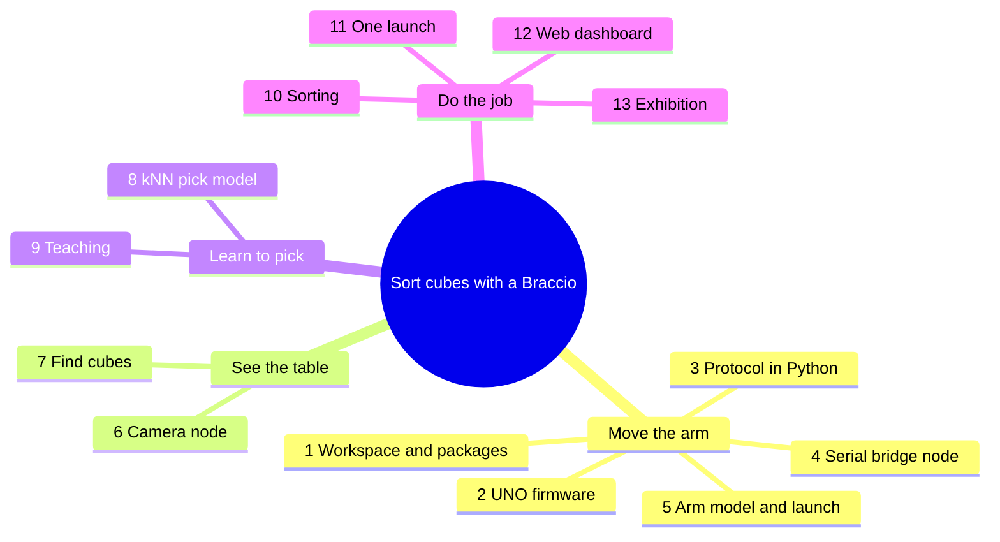
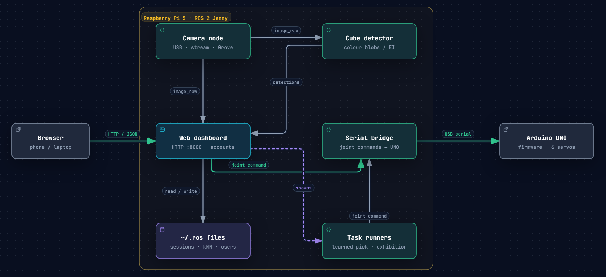

# Rebuild the Braccio cube sorter

You're going to rebuild this project from an empty folder. Each chapter has
**one objective**: why we need it now, what to create, the real code with an
explanation of how it works, a way to check it runs, and what's still missing,
which leads to the next chapter.

## The mind map

Everything grows from one goal: *a robot arm that sorts cubes by itself.* We build
the branches left to right. Each one needs the one before it.



And this is where we end up. Every box is a chapter:



[Open the interactive diagram](img/architecture.html){ target=_blank }: click a box to see its source.

## How to use this guide

1. **Two folders.** Keep the original repo for reference, and build yours next to it:

    === "Raspberry Pi / Linux"

        ```bash
        # Saved in ~/.bashrc so every new terminal has them
        echo 'export ORIG=~/unoq-braccio' >> ~/.bashrc       # the original repo
        echo 'export NEW=~/braccio-rebuild' >> ~/.bashrc     # yours, built from scratch
        source ~/.bashrc
        echo "$NEW"                                          # must print a path
        ```

        Chapter 1 creates `~/braccio-rebuild`. Don't point `NEW` at an existing
        folder such as `~/ros2_ws`.

    === "Windows (PowerShell)"

        ```powershell
        $ORIG = "$HOME\Downloads\unoq-braccio"
        $NEW  = "$HOME\braccio-rebuild"
        ```

2. **Read a section, then type its code into your file.** Each code block shows
   the original file and line numbers, so you always know exactly where it goes.
   Typing is the point. The copy button is there for long, boring parts.
3. **Some files are support code:** a chapter will say *"copy this file as-is"*.
   They aren't part of the main idea (a keyboard helper, a settings loader), so
   you read them and move on.
4. **Run the check at the end of every chapter** before moving on.
5. Tick the chapter off:
    - [ ] 1 · [ ] 2 · [ ] 3 · [ ] 4 · [ ] 5 · [ ] 6 · [ ] 7 · [ ] 8 · [ ] 9 · [ ] 10 · [ ] 11 · [ ] 12 · [ ] 13

!!! tip "What runs where"
    Chapters 3, 7, 8 and 13 have checks that run on any PC with Python
    (`pip install numpy pyyaml opencv-python`). Everything else runs on the
    Raspberry Pi with ROS 2 Jazzy and the arm. Set that up first with
    `docs/raspberry-pi.md` in the original repo.

## Serving this guide

On Ubuntu 24.04:

```bash
# 1. Install MkDocs (open a new terminal after this step)
sudo apt install pipx
pipx ensurepath
pipx install mkdocs-material --include-deps

# 2. Get this branch
git clone -b build-guide https://github.com/hwivc/unoq-braccio.git
cd unoq-braccio

# 3. Run the guide
mkdocs serve
```

Then open <http://127.0.0.1:8000>. Press `Ctrl+C` to stop. The code blocks are read live from the
repo, so they always match the files.
