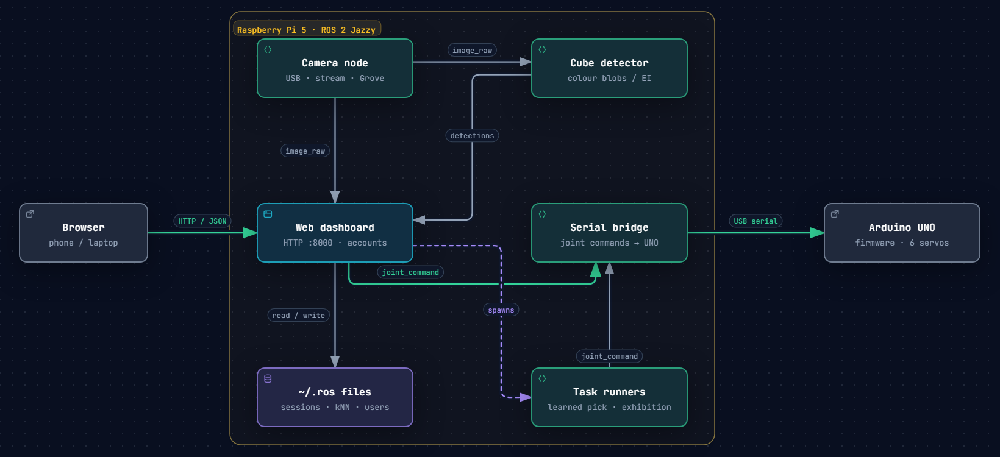

# Arduino Braccio + ROS 2

A TinkerKit Braccio arm that finds coloured cubes with an overhead camera and
sorts them. You teach it to pick by driving it onto a few cubes; a small learned
model (kNN) maps camera readings straight to servo angles, so no camera or arm
calibration is needed. Everything runs headless on a Raspberry Pi 5 and is
controlled from a web page.

## Features

- **Learned picking**: teach a few examples; the arm auto-collects the rest and
  picks anywhere in the taught area.
- **Web dashboard**: live 3D arm, camera, controls and logs on any phone or
  laptop, with owner / operator / viewer accounts.
- **Exhibition mode**: arranges cubes into patterns for hours, with a big-screen
  view for a TV.
- **Simulation**: Gazebo world with inverse-kinematics pick and place.
- **Plug and play**: finds the UNO and camera by USB id and reconnects when
  they're re-plugged.

## Architecture

`pi.launch.py` runs everything inside the box on the Pi. The web dashboard
sends joint commands to the serial bridge, which drives the UNO over USB, and
starts the sort and exhibition task runners. There is also an
[interactive version](architecture.html){ target="_blank" } of this diagram.

## Where to start

| Topic | Guide |
|---|---|
| Raspberry Pi 5 setup | [Raspberry Pi 5](raspberry-pi.md) |
| Other operating systems | [Windows / macOS / Linux](platform-setup.md) |
| Wiring and serial protocol | [Hardware](hardware.md) |
| Camera setup and calibration | [Camera](camera.md) |
| Web dashboard and exhibition mode | [Web dashboard](web-dashboard.md) |
| Launch files and troubleshooting | [Terminal tools](terminal-tools.md) |

The source code, Edge Impulse integration and simulation internals are in the
[GitHub repository](https://github.com/hwivc/unoq-braccio).
