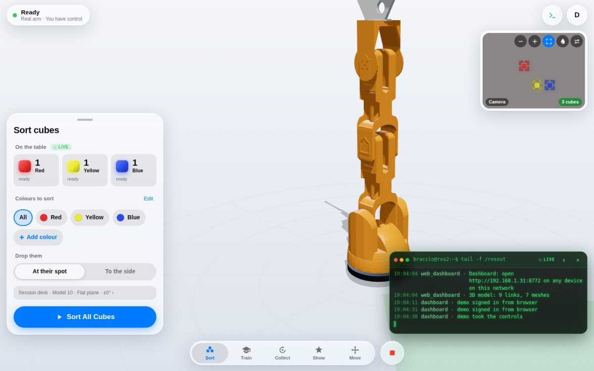
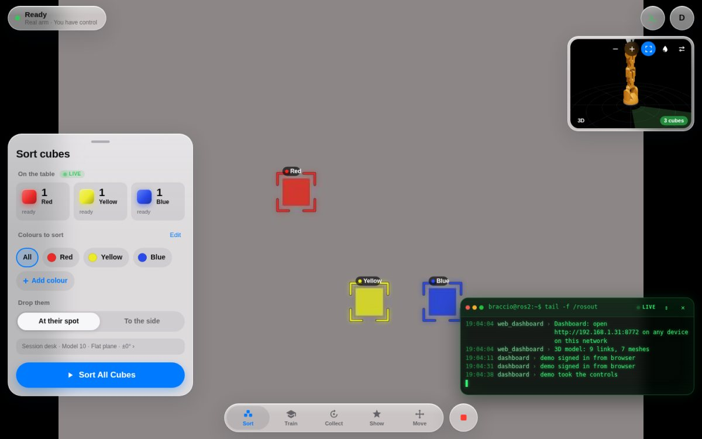
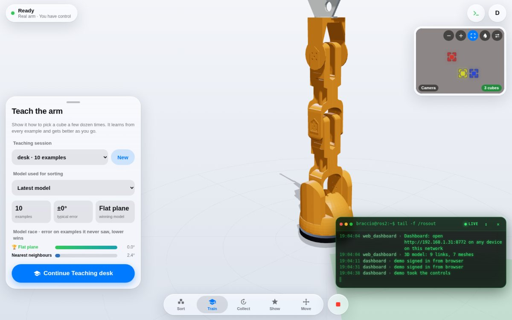
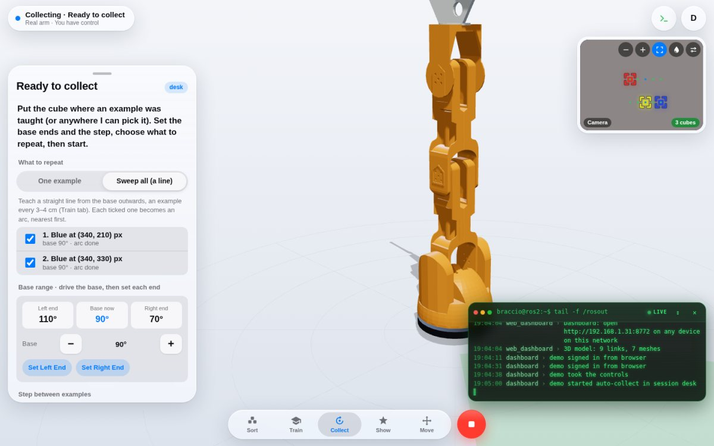
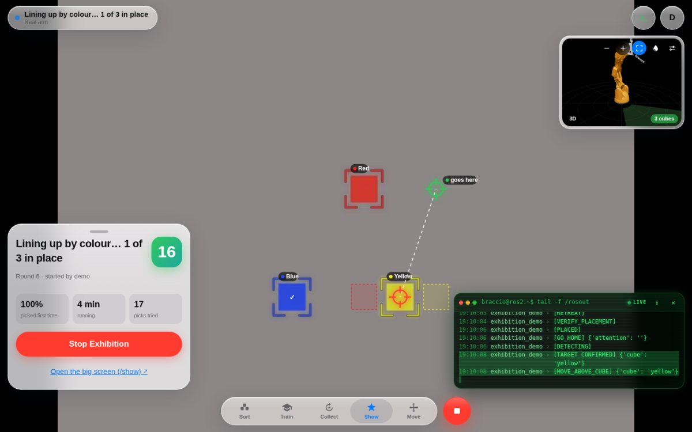
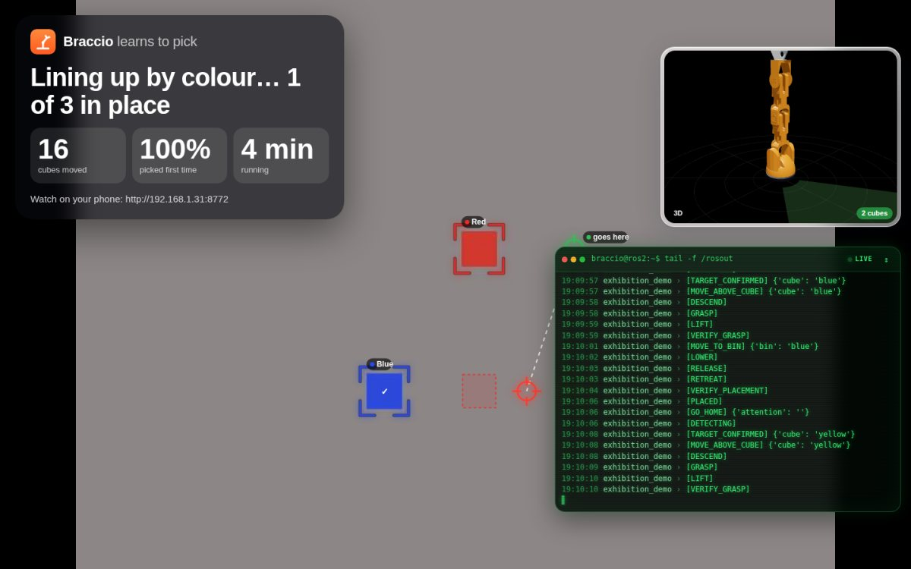
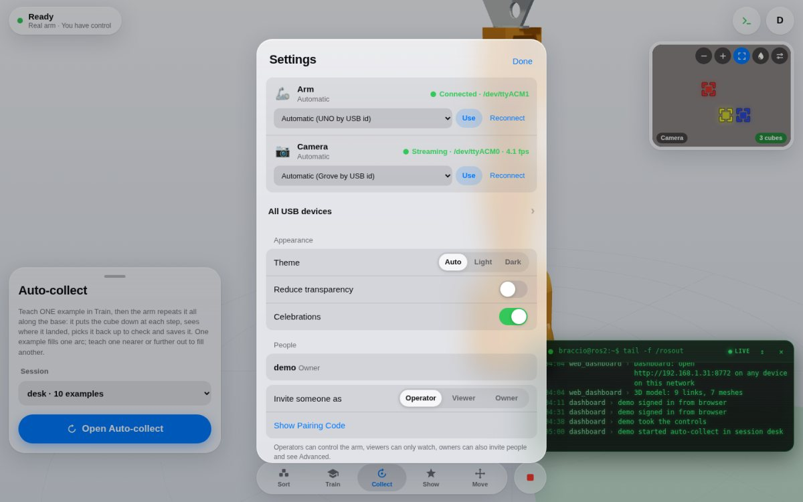
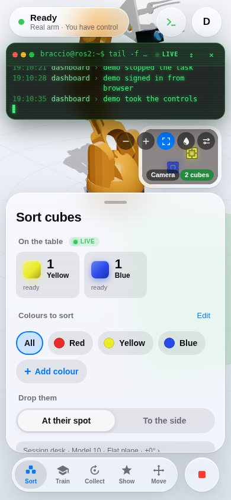

# Web dashboard

Watch and control the arm from any phone, tablet or computer on the same
network: a live 3D model of the arm (the same URDF and transforms RViz uses),
the overhead camera, what the arm is doing, and the controls. It works with
the real arm and with the simulation.

Start it with [the one command](../README.md#quick-start) (or `sim.launch.py web:=true`).

| | |
|---|---|
|  **Sort**: the cubes it sees, colours, 3D arm, camera, live log |  **Camera** enlarged: a labelled box around every cube |
|  **Train**: teach examples, the model race |  **Collect**: Sweep all turns a taught line into a grid |
|  **Show** running: pattern targets and the next move |  **`/show`**: the big screen for a TV |
|  **Settings → Devices**: arm and camera, found by USB id |  **On a phone** |

The terminal prints the address (e.g. `http://192.168.1.31:8000`) and, the
first time, a **pairing code**: open the address, enter the code and choose a
name and password. That makes you the owner. Invite others in Settings →
**Show Pairing Code**: each code works once, for 10 minutes, as an
**operator** (can control), **viewer** (can only watch) or **owner** (can also
invite people and see Advanced).

| Where | What |
|---|---|
| Sort | **On the table**: the cubes the camera sees right now, per colour, and whether the model has been taught where they are (or, when it sees none, why: no colours saved, a blob too big or cut off). Pick colours (or All), drop at their spot or to the side, Start. Shows each step live, the cubes placed and a counter. **Add colour**: put a cube on the table, tap it in the camera picture, name it, save (same name = measure it again); **Edit** removes colours |
| Train | Teach the arm from the browser, the same flow and sessions as `teach_pick`: pick or create a session, **Record Example** (Above → Grab → Close → Check, driving with the on-screen +/− buttons), **Test Me**, drop spots, review, undo. Shows the "model race" (each candidate's error) and lets you choose the model Sort uses |
| Collect | **Auto-collect**: teach ONE example in Train, set the base's two ends and a step (3/5/10°); the arm repeats that example at every step: puts the cube down, reads where it landed, picks it back up to check, saves it. One example fills one arc; **Sweep all** sweeps every ticked taught example in turn, so a straight line of 4–6 examples taught from the base outwards becomes a grid over the whole table. Only asks for OK to hand over or put back a lost cube. Dots on the camera show the covered spots |
| Show | Exhibition mode: base window, playlist of patterns, rests, Start / Stop, counters; link to the `/show` big screen |
| Move | Gripper open / close, Home and other poses; Joints (folded away) has a slider per servo |
| Stop (red, bottom right) | Stops the task (or teaching's current move) and holds the arm where it is. Always there; `Esc` on a keyboard |
| Camera (top right) | Tap to swap with the 3D view. Boxes and labels mark the cubes it sees, dashed boxes the coloured blobs it rejected and why, the cube being picked and where it goes, and an exhibition pattern's targets. Buttons: smaller / bigger, boxes on / off, 💧 colour mask (paints every pixel of each saved colour, to check a colour still matches), picture adjust (zoom, brightness, contrast, rotate, mirror; kept per browser) |
| Live log (`>_`, bottom right) | Every ROS node's log (`/rosout`), live, green on black; warnings amber, errors red |
| Settings | Account, **Devices** (arm and camera status, every USB serial device and camera; owners can pin the arm or camera to a port, switch to another camera or a stream URL, or reconnect, with no restart), theme, Reduce Transparency, Celebrations, people; Advanced: examples review, drop mode, raw servo values |
| `/show` | The big screen for a TV: what the arm is doing in large type, counters, camera, 3D arm and live log |

Only one person drives at a time; others see who is in control and can take
over. Drag to orbit the 3D view, pinch or scroll to zoom, double-click to reset.
Accounts are in `~/.ros/braccio_web.yaml` (salted password hashes; delete an
entry to remove someone). After an update, a normal reload of the page is
enough (the page is never cached). Port: `web_port:=8080` on the launch. For
HTTPS on an untrusted network, run the dashboard on its own with
`ros2 run unoq_braccio_driver web_dashboard --ros-args -p certfile:=... -p keyfile:=...`.

## Exhibition mode

For a show: the arm keeps moving cubes around the table on its own for
hours, making one pattern after another from a **playlist**: *line up by colour*, *circle* (the cubes on one collected arc), *colour zones*, *swap* two cubes (through a free spot) and *shuffle*. The camera shows each pattern's targets as ghost squares, the big screen narrates ("Making a circle… 2 of 3 in place"), and a finished shape gets confetti and a wave, nod or dance. It rests between rounds so the servos cool down. Patterns only use known spots (taught or auto-collected examples), placing with each spot's own pose, so a dense grid from **Collect → Sweep all** makes the neatest shapes. In the web dashboard's **Show** tab:

1. **Base window**: drive the base with − / + to the furthest it may turn one
   way, **Set Left End**; the other way, **Set Right End**. The window shows
   as a green wedge in the 3D view.
2. Choose the patterns in the **playlist**, the rest (15 s – 2 min) and cubes
   moved per shuffle, then **Start Exhibition**.
3. Open **`http://<pi>:8000/show`** on a TV or monitor: a big screen with what
   the arm is doing, cubes moved, success rate, the camera, the 3D arm and the
   live log (sign in once, as a viewer).

Cubes are only ever put down on **taught spots** (places where a cube really
sat and the arm really picked it up), inside the base window, and at least two
cube widths from any other cube, so they never land off the table or on each
other. Teach spots across the whole area you want used (keep them away from
the table edge), and keep the cubes inside it.

It stops and shows **Needs a hand** (on the page and the big screen) when a
cube goes missing (it carries on by itself once it sees them all again, or
with fewer cubes after a few more looks), after 3 missed picks in a row, or
when no free spot is left. Settings are in `~/.ros/braccio_exhibition.yaml`
and are re-read every round. From a terminal:
`ros2 run unoq_braccio_driver exhibition_demo --ros-args -p session:=<name>`.
